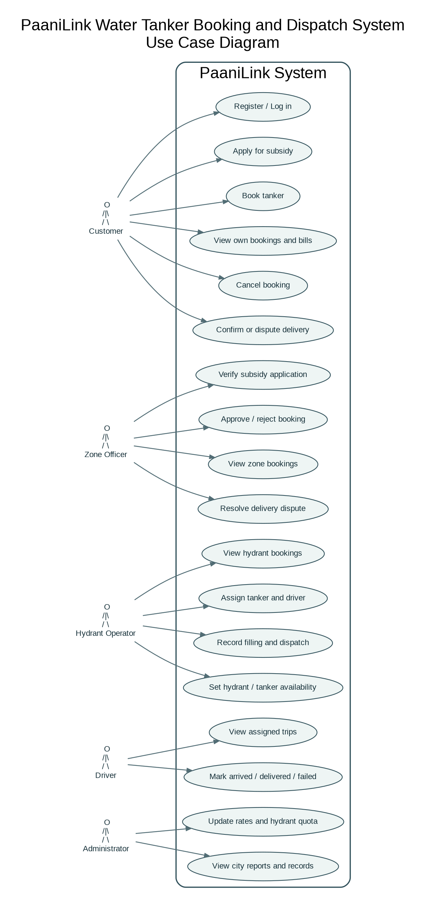

# PaaniLink Use Case Diagram

The diagram below shows the main actions available to each role in the Mid Evaluation frontend.

```mermaid
flowchart LR
    Customer([Customer])
    Officer([Zone Officer])
    Operator([Hydrant Operator])
    Driver([Driver])
    Admin([Administrator])

    subgraph System[ PaaniLink Water Tanker Booking and Dispatch System ]
      UC1((Register / Log in))
      UC2((Apply for subsidy))
      UC3((Book tanker))
      UC4((View own bookings and bills))
      UC5((Cancel booking))
      UC6((Confirm or dispute delivery))
      UC7((Verify subsidy application))
      UC8((Approve / reject subsidised booking))
      UC9((Handle delivery dispute))
      UC10((View zone bookings))
      UC11((View hydrant bookings))
      UC12((Assign tanker and driver))
      UC13((Record filling and dispatch))
      UC14((Set hydrant / tanker availability))
      UC15((View assigned trips))
      UC16((Mark arrived / delivered / failed))
      UC17((Manage rates and hydrant quota))
      UC18((View city reports and records))
    end

    Customer --> UC1
    Customer --> UC2
    Customer --> UC3
    Customer --> UC4
    Customer --> UC5
    Customer --> UC6
    Officer --> UC7
    Officer --> UC8
    Officer --> UC9
    Officer --> UC10
    Operator --> UC11
    Operator --> UC12
    Operator --> UC13
    Operator --> UC14
    Driver --> UC15
    Driver --> UC16
    Admin --> UC17
    Admin --> UC18
```

## Actor summary

- **Customer:** registers, applies for subsidised status, books and cancels tankers, views own records, and confirms or disputes delivery.
- **Zone Officer:** checks subsidy applications, reviews subsidised bookings, views bookings in their zone, and resolves disputes.
- **Hydrant Operator:** manages the assigned hydrant's availability, assigns a suitable tanker and driver, and records filling and departure.
- **Driver:** views assigned trips and records arrival, delivery, or failure with a reason.
- **Administrator:** views city-level records and reports and updates sample rates and hydrant quotas.
